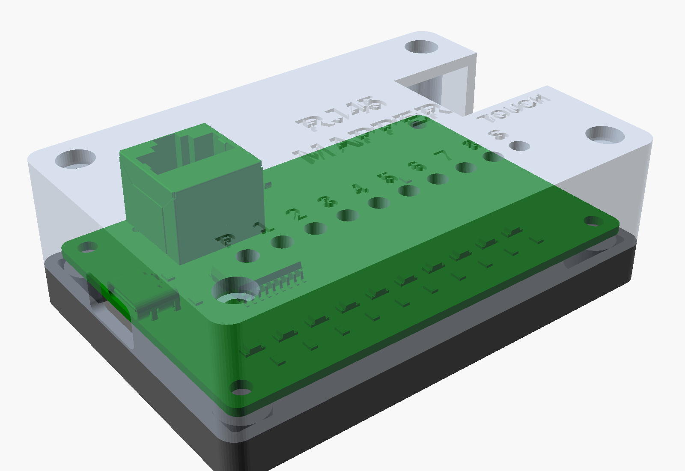

# rj45-mapper

A bench probe for unknown cables that have an 8P8C (RJ45) plug on one end and loose
wires on the other. Plug the cable into the jack and touch one loose wire to the
pad. The LED for the jack pin that wire lands on lights up. If two pins are shorted
together in the cable, two LEDs light. A shielded cable's drain wire lights S.

## How it works

The pad sits at 5 V through 1k. Each jack pin drives one input of a ULN2803A, and
each ULN output sinks one red LED through 330R (about 7 mA). The shield tabs of the
jack drive a ninth channel, an MMBT3904 with the same 2.7k / 10k input network. A
wire grounded at its far end draws 5 mA from the pad, so it is not a short. A finger
across the pad and a wire (around 1 Mohm) puts the input under 0.1 V, far below the
ULN's on-threshold, so only metal contact lights an LED. Power is USB-C at 5 V, with
a separate 5.1k on each CC pin.

## Parts

JLC assembles everything except the jack: `fab/rj45-mapper-bom.csv` and
`fab/rj45-mapper-cpl.csv`. The jack is an RCH RC01937 (LCSC C708652), through-hole,
listed in `fab/hand-solder.csv`. Its pins and pegs match the standard 8P8C land
pattern (1.27 mm pitch, rows 2.54 mm apart, 3.25 mm pegs 11.43 mm apart), and its
two shield tabs add two more holes. Check the part rotations in JLC's placement
preview before ordering (U1, Q1 and the LEDs are polarized).

## Case

`case/case.scad` (OpenSCAD) has a base and a lid that clamp the board between them
with four M3x20 screws through the mounting holes. The pilot holes in the base are
2.6 mm for self-tapping screws; set `PILOT_D = 4.0` for heat-set inserts. The lid has
one light tube per LED, with the channel numbers debossed beside them, and openings
for the jack, the USB-C plug and the pad. There are no overhangs that need support.
`case/fit_check.py` tests every component triangle of the populated board against
the case solids (the board meshes are not closed, so OpenSCAD cannot intersect them).

## Building

`tools/build.sh` regenerates everything: schematic, ERC, a pin-by-pin netlist check,
placement and a scripted route, pours, DRC with schematic parity, a routing geometry
check, renders and fab outputs. `case/render.sh` makes the case STLs and renders.
Needs KiCad 10 with `kicad-packages3d`, OpenSCAD and ImageMagick.
